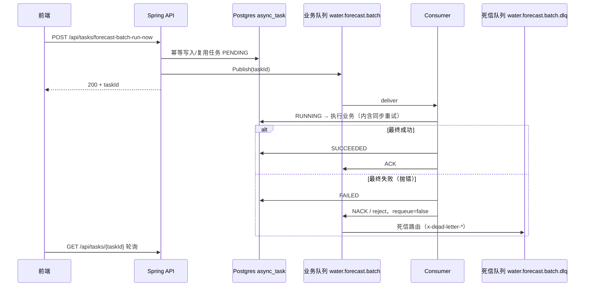

# MQ 使用说明（批量预测 · RabbitMQ）

本文档描述 **仅「批量预测」异步任务** 接入 RabbitMQ 的架构、**死信队列（DLQ）**、**prefetch / concurrency** 保护下游 AI 的原理，以及本仓库中的**实现方式**。IV 刷新仍走进程内线程池，不经本业务队列。

---

## 1. 为什么要用 MQ（必要性）

| 痛点（仅线程池 + DB 任务表时） | MQ 带来的帮助 |
|-------------------------------|---------------|
| 突发多次点击 / 多用户同时提交 | 请求快速 **入队**，由消费者按并发度消化，**削峰** |
| 批量预测长时间占用线程、调用链长 | **提交与执行解耦**，API 进程不被长任务拖死 |
| 多实例部署时，任务在各自 JVM 内 | 消息集中在 Broker，可统一由 **worker 消费**（后续可独立扩容） |
| 进程崩溃、发布重启 | 依赖 Broker **持久化消息**（需正确配置 + 消费者 ACK），减少「已接单未执行」类丢失 |
| 消费失败需要可审计的归宿 | **DLQ（死信队列）** 保留最终失败的消息，便于排查与人工处理 |

**简历/面试一句话**：将多站点批量预测改为 **RabbitMQ 异步消费**，用 **prefetch/concurrency** 限制对 AI 的并发压力，用 **DLQ** 承接最终失败消息，与 DB 任务状态配合形成可观测闭环。

**本阶段范围**：只迁移 **`FORECAST_BATCH_RUN_NOW`（批量预测）**；IV 刷新等保持现状。

---

## 2. 消息流转（含 DLQ）



**要点**：

- **真相源**仍是 `async_task`（状态、进度、结果）；MQ 负责 **投递、削峰、失败消息的 DLQ 归宿**。
- 业务队列声明了 **`x-dead-letter-exchange`** 与 **`x-dead-letter-routing-key`**：当消息被 **拒绝且不 requeue** 时，Broker 将其转发到死信交换机，再进入 **DLQ**，而不会在业务队列里无限打转。

---

## 3. DLQ（死信队列）原理与本项目中的含义

### 3.1 原理（白话）

- 消费者处理一条消息时，可能 **抛异常** 或对消息 **reject/nack** 且 **`requeue=false`**。
- 若业务队列配置了 **死信交换机 + 死信路由键**，这条消息不会直接丢弃，而是被送到 **DLQ**，相当于「失败件的专门收件箱」。
- 你可以在 RabbitMQ **管理界面**里打开 DLQ，看到 **仍失败的消息体**（含 `taskId`），便于对照 DB 里 `FAILED` 的任务排查。

### 3.2 在本仓库中如何触发 DLQ

1. 消费者 `AsyncTaskMqConsumer`（仅 **`worker` profile** 进程加载）调用 `AsyncTaskService.consumeForecastBatchTaskFromQueue(taskId)`。
2. 批量预测在 **当前线程** 内做 **同步业务重试**（与 IV 任务使用的线程池重试区分），仍失败则 `markFailed`，然后抛出 **`ForecastBatchMessageDeadLetterException`**。
3. Spring AMQP 监听器未捕获该异常 → 对消息 **否定确认**；配置 **`spring.rabbitmq.listener.simple.default-requeue-rejected=false`** → **不回到业务队列** → 满足死信条件 → 消息进入 **`water.forecast.batch.dlq`**。

### 3.3 为何关闭容器级 `retry`（`spring.rabbitmq.listener.simple.retry.enabled=false`）

- 批量预测已在 **业务层** 按 `MAX_RETRIES` 做重试；若再开启 **监听器级** 重试，可能对 **同一条已 `FAILED` 的 taskId** 再次投递，与 DB 状态更容易冲突。
- 最终失败由 **一次抛错 → DLQ** 收底，路径更清晰。

### 3.4 修改队列参数（重要）

业务队列 **`water.forecast.batch`** 若已在 RabbitMQ 里创建过 **且未带死信参数**，Spring 声明的新参数 **不会自动覆盖**。本地开发请任选其一：

- 在管理界面 **Delete** 该队列后重启应用（会丢队列中未消费消息，开发环境通常可接受）；或  
- 改用 **新队列名**（同步改 `water.mq.forecast.queue`）。

---

## 4. prefetch 与 concurrency：如何保护 `:8000` AI 服务

### 4.1 原理（白话）

- **concurrency / max-concurrency**：同时有多少个 **消费者线程** 在拉消息、跑批量逻辑。调小 → 同一时刻跑的批量任务更少。
- **prefetch**：每个消费者线程在 **未 ACK** 前，最多 **预取** 多少条消息。调小 → 即使队列里堆了很多消息，也不会一次「囤」大量在途任务，**在途量约等于 `prefetch × 实际并发消费者数`**。

把两者调低，等价于限制 **同时向 AI 发起的压力**，避免把 `localhost:8000` 打满导致全线超时。

### 4.2 本仓库配置位置

见 `application.properties`：

- `spring.rabbitmq.listener.simple.prefetch`
- `spring.rabbitmq.listener.simple.concurrency`
- `spring.rabbitmq.listener.simple.max-concurrency`

可按机器与 AI 服务能力调整；**个人项目**可从 `concurrency=1`、`prefetch=3` 起，观察 AI CPU/延迟后再略增。

---

## 5. 代码与配置对应关系（实现清单）

| 环节 | 位置 |
|------|------|
| 交换机 / 业务队列 / DLX / DLQ / binding | `config/RabbitMqConfig.java` |
| JSON 消息体 | `dto/ForecastBatchTaskMessage.java` |
| 提交后发 MQ | `AsyncTaskService.publishForecastBatchTask` |
| 消费 | `service/AsyncTaskMqConsumer`（`@Profile("worker")`）→ `AsyncTaskService.consumeForecastBatchTaskFromQueue` |
| Worker 进程入口 | `WaterBusinessWorkerApplication`；配置 `application-worker.properties`（无业务 Web，`management.server.port=8088` 健康检查） |
| 同步重试 + 最终失败抛错进 DLQ | `AsyncTaskService.runForecastBatchTask(..., syncRetry=true)`、`ForecastBatchMessageDeadLetterException` |
| Broker 连接与消费者行为 | `application.properties`：`spring.rabbitmq.*`、`spring.rabbitmq.listener.simple.*`、`water.mq.forecast.*` |

---

## 6. API 与独立 Worker（对齐常见「大厂」部署）

- **API 进程**（默认 profile）：只提供 HTTP、写 `async_task`、**发布** MQ；**不注册** `@RabbitListener`（消费者 Bean 仅在 `worker` profile 生效）。
- **Worker 进程**（`spring.profiles.active=worker`）：**不启动**业务 Web 端口（`spring.main.web-application-type=none`），只连 DB / Rabbit / Feign 等执行批量预测；健康检查见 `application-worker.properties` 中的 `management.server.port`。
- **制品**：同一 JAR，两套命令（或 IDE 分别运行 `WaterBusinessApplication` 与 `WaterBusinessWorkerApplication`），与多数团队「**同镜像、不同启动参数、水平扩 Worker**」一致。

**失败任务运维手册（Runbook）**：见 [`mq-runbook.md`](./mq-runbook.md)（健康检查、DLQ 处理、重放原则、排障表）。

---

## 7. 本地用 Docker 启动 RabbitMQ

### 7.1 使用本仓库 `docker-compose.yml`（推荐）

仓库目录结构：Java 在 **`monitor_business/backend/`**，前端在 **`monitor_business/frontend/`**（见 `monitor_business/README.md`）。

**仅起 Broker（本地代码跑 API/Worker 时）**：

```bash
cd monitor_business
docker compose up -d rabbitmq
```

**在镜像里跑 API + Worker + Redis + Postgres + RabbitMQ**（与 `docs/mq-runbook.md` 4.4 节一致）：

```bash
cd monitor_business
docker compose up -d --build postgres redis rabbitmq ai-inference-service monitor-service task-worker api-gateway
```

其中 **`ai-inference-service`** 由仓库 **`ai_service/Dockerfile`** 构建，Java 侧已配置 **`WATER_AI_BASE_URL=http://ai-inference-service:8000`**。对外 HTTP 经 **`api-gateway`**（`:8080`）；直连业务与 Actuator 为 **`http://localhost:18080`**。仅本地跑 Python、Java 仍在容器时，见 [`mq-runbook.md`](./mq-runbook.md) 4.4 节说明。

- **AMQP**：`localhost:5672`
- **管理界面**：<http://localhost:15672>（默认 `guest` / `guest`，与 compose 中环境变量一致）

查看业务队列与 DLQ：管理台 **Queues** → `water.forecast.batch`、`water.forecast.batch.dlq`。

### 7.2 端口冲突

若 `5672` / `15672` 被占用，修改 `docker-compose.yml` 的 `ports` 映射，并同步修改 `spring.rabbitmq.port`等。

---

## 8. 与路线图文档的关系

总览见 `distributed-system-plan.md` **Phase 3**。死信与消费限速属于 Phase 3 中 **可靠消费 + 保护下游** 的落地；后续可再扩展 DLQ 的告警、人工重放脚本等。
