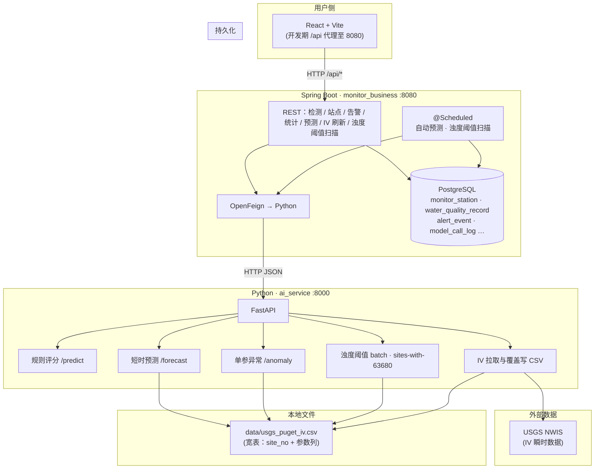
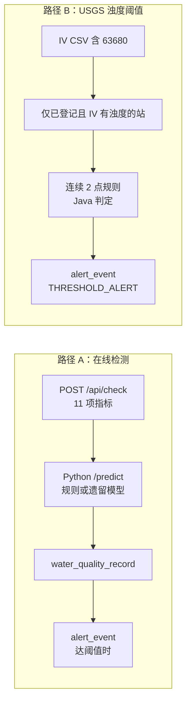

# 系统架构一页总览

面向简历/汇报：**浏览器 → Spring 业务与持久化 → Python AI 与 USGS 数据 → PostgreSQL**。下方图可在支持 Mermaid 的编辑器（VS Code、GitHub、Notion、Typora）中直接渲染；也可粘贴到 [mermaid.live](https://mermaid.live) 导出 PNG/SVG。

---

## 1. 总体部署与数据流

---

## 2. 两条核心告警链路（概念）

---

## 3. 技术栈速览

| 层级  | 技术                                                               |
| --- | ---------------------------------------------------------------- |
| 前端  | React 18、Vite、Axios、Leaflet、Recharts                             |
| 后端  | Spring Boot 3、JPA、OpenFeign、Resilience4j、Actuator/Prometheus（可选） |
| AI  | Python 3、FastAPI、pandas、scikit-learn（预测/异常按需）                    |
| 数据  | PostgreSQL（默认），可选 H2                                             |

---

## 4. 与详细文档的关系

- 接口清单与请求体：**[api.md](./api.md)**  
- 表结构与字段：**[database-schema.md](./database-schema.md)**  
- 业务分层与演进说明：**[architecture.md](./architecture.md)**（长文）

---

*文档版本：与当前仓库实现一致；若端口或路径变更，请同步更新上图。*