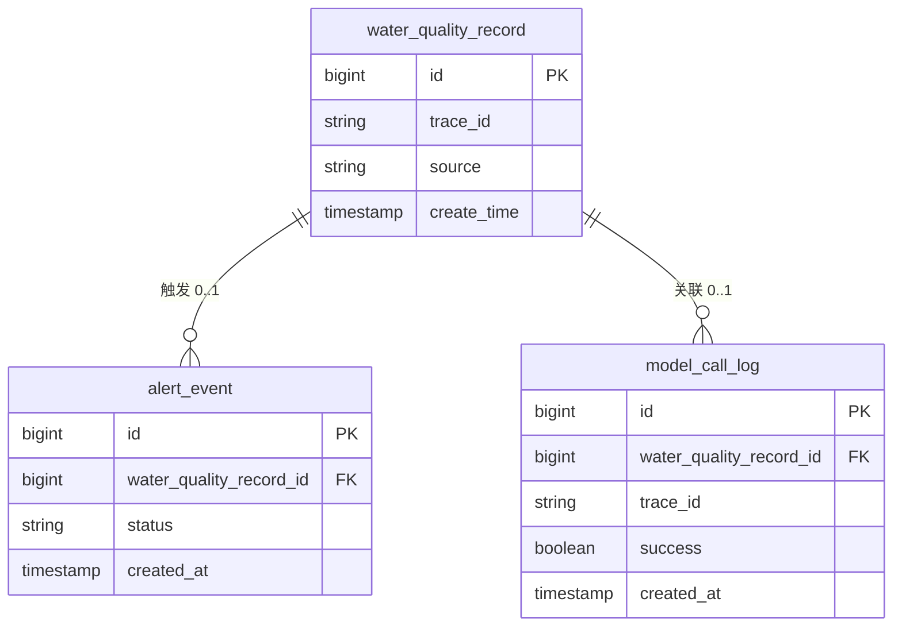

# 数据库表结构及表关系说明

本文描述 `monitor_business` 当前由 JPA（`ddl-auto=update`）维护的表、字段含义及**逻辑关联**；并包含 **GIS / 站点与批量导入 CSV** 对齐的演进规划（见 **[§7](#7-表结构演进gis--站点主数据计划)**）。

- **默认库**：**PostgreSQL**（连接说明见 [postgresql-setup.md](./postgresql-setup.md)）。
- **可选**：`spring.profiles.active=h2` 时使用 **H2 文件库**（`application-h2.properties`）。

实体层未声明 `@ManyToOne` / `@JoinColumn`，外键仅在业务与字段命名上约定一致；若后续需要数据库级 FK，可再增加迁移脚本。

---

## 1. 关系总览



**文字归纳：**

| 父表 | 子表 | 基数 | 关联字段 | 说明 |
|------|------|------|----------|------|
| `water_quality_record` | `alert_event` | 1 : 0..1 | `alert_event.water_quality_record_id` → `water_quality_record.id` | 仅当本次检测的污染等级达到配置阈值时插入一条告警；同一检测最多对应一条告警（当前实现）。 |
| `water_quality_record` | `model_call_log` | 1 : 0..1 | `model_call_log.water_quality_record_id` → `water_quality_record.id` | AI 调用**成功且已落检测记录**后写一条成功日志；与检测记录一一对应。 |
| （无父记录） | `model_call_log` | — | `water_quality_record_id` 为 `NULL` | AI 调用**失败**（未写入 `water_quality_record`）时仍会写失败日志，此时无外键目标。 |

**与链路追踪：** `water_quality_record.trace_id`、`model_call_log.trace_id` 与请求 MDC / 响应头 `X-Trace-Id` 对齐，便于跨表排查同一次请求。

---

## 2. 表：`water_quality_record`

水质检测事实表，一次成功的 `/api/check` 对应一行（在 AI 返回成功并完成保存的前提下）。

| 列名（DB） | 含义 |
|------------|------|
| `id` | 主键 |
| `water_temperature_c` … `heavy_metals_pb_ug_l` | 与 Python 模型一致的 11 项指标 |
| `pollution_level` | AI 预测的污染等级文本 |
| `create_time` | 写入时间 |
| `trace_id` | 链路 ID |
| `source` | 来源枚举字符串，默认 **`API`**（`RecordSource`，JPA `EnumType.STRING`） |

---

## 3. 表：`alert_event`

告警事件表，由业务规则（当前为代码内阈值 + `water.alert.threshold`）决定是否插入。

| 列名（DB） | 含义 |
|------------|------|
| `id` | 主键 |
| `water_quality_record_id` | 指向触发本次告警的检测记录；逻辑外键 |
| `alert_type` | 告警类型，如 `POLLUTION_THRESHOLD` |
| `severity` | 严重度，如 `MEDIUM` / `HIGH` |
| `status` | `NEW` / `ACK` / `CLOSED` |
| `pollution_level` | 触发时的等级快照 |
| `title` / `detail` | 标题与说明 |
| `rule_code` | 规则标识，如 `HARDCODED_LEVEL_THRESHOLD` |
| `created_at` | 产生时间 |
| `acknowledged_at` / `acknowledged_by` | 确认信息 |
| `closed_at` / `closed_by` / `remark` | 关闭时间、关闭人、备注（关闭备注可追加在 `remark`） |

---

## 4. 表：`model_call_log`

模型调用日志，与检测记录弱耦合，用于审计与排障。

| 列名（DB） | 含义 |
|------------|------|
| `id` | 主键 |
| `water_quality_record_id` | 成功路径下关联检测记录；失败时为 `NULL` |
| `trace_id` | 链路 ID |
| `success` | 是否调用成功 |
| `http_status` | HTTP 状态（若可得，如 Feign 4xx/5xx） |
| `duration_ms` | 耗时 |
| `error_message` | 失败时的错误摘要 |
| `request_json` / `response_json` | 请求/响应 JSON 摘要（有长度截断） |
| `created_at` | 记录时间 |

---

## 5. 当前未落地的表

架构文档中曾规划的 **`rule_config`** 等表**暂未实现**（主功能完成后再优化，见 [TODO.md](./TODO.md)）；规则参数目前由 **`water.alert.threshold`** 与代码 **`PollutionLevelThresholds`** 承担。

---

## 6. 与代码的对应关系

| 表名 | JPA 实体 |
|------|----------|
| `water_quality_record` | `WaterQualityRecord` |
| `alert_event` | `AlertEvent` |
| `model_call_log` | `ModelCallLog` |
| `monitor_station`（计划） | `MonitorStation`（计划） |

---

## 7. 表结构演进：GIS / 站点主数据（计划）

为支撑 **Leaflet 等地图** 展示与 **简历/前端驾驶舱**，在保留现有检测—告警—日志主线的前提下，引入 **监测站点主数据表**，并在检测事实表上挂接站点与样本时间。  
**不需要 PostGIS**：普通 `DOUBLE PRECISION` / `DECIMAL` 存经纬度即可；复杂空间检索再上扩展。

### 7.1 设计原则

| 原则 | 说明 |
|------|------|
| 主数据 + 事实 | 经纬度、行政区、站点编码落在 **`monitor_station`**；**`water_quality_record`** 只存一次检测的指标与预测结果，避免每条记录重复省市区坐标。 |
| 兼容现有 API | 纯 **`POST /api/check`**、未选站点时：`station_id` 可为 **`NULL`**，地图层可过滤或显示「未绑定站点」类数据。 |
| 样本时间 | CSV 有监测日期字段；与「写入时间 `create_time`」分离，便于按**自然日/采样时刻**统计与回放。 |
| 告警冗余（可选） | **`alert_event.station_id`** 可选冗余，便于地图只扫告警表；否则通过 `water_quality_record_id` join 亦可。 |

### 7.2 关系总览（目标形态）

```mermaid
erDiagram
    monitor_station ||--o{ water_quality_record : "1 : N"
    water_quality_record ||--o{ alert_event : "触发 0..1"
    water_quality_record ||--o{ model_call_log : "关联 0..1"

    monitor_station {
        bigint id PK
        string station_code UK
        decimal latitude
        decimal longitude
    }

    water_quality_record {
        bigint id PK
        bigint station_id FK_nullable
        timestamp sample_time_nullable
        string trace_id
        timestamp create_time
    }

    alert_event {
        bigint id PK
        bigint water_quality_record_id FK
        bigint station_id FK_nullable
    }
```

### 7.3 新表：`monitor_station`（计划）

监测站点维度表；批量导入时 `station_code` 可与 CSV 中的站点编码列一一对应（唯一）。

| 列名（DB，建议） | 类型（建议） | 含义 |
|------------------|--------------|------|
| `id` | BIGINT PK | 主键 |
| `station_code` | VARCHAR(64) UNIQUE NOT NULL | 站编码（业务唯一），如 `puget_alpha_01` 或与导入 CSV 中站点列一致 |
| `external_id` | VARCHAR(32) NULL | 可选；外部数据源主键，如 **USGS 8 位 `site_no`**（与 IV CSV / 短时预测对齐） |
| `station_name` | VARCHAR(128) | 展示名，缺省可与 `station_code` 相同 |
| `province` | VARCHAR(64) | 省/直辖市 |
| `city` | VARCHAR(64) | 市 |
| `latitude` | DECIMAL(9,6) NOT NULL | 纬度（WGS84，与 CSV `Latitude` 一致） |
| `longitude` | DECIMAL(9,6) NOT NULL | 经度 |
| `status` | VARCHAR(16) | 如 `ACTIVE` / `INACTIVE`，默认 `ACTIVE` |
| `created_at` | TIMESTAMP | 创建时间 |
| `updated_at` | TIMESTAMP | 更新时间 |

**说明：** 不需要 PostGIS 即可支撑 Leaflet 打点；后续若有「半径检索、行政区多边形」再评估 `geometry` + PostGIS。

### 7.4 表：`water_quality_record` 扩展列（计划）

在现有 11 项指标、`pollution_level`、`create_time`、`trace_id`、`source` 基础上增加：

| 列名（DB，建议） | 类型（建议） | 含义 |
|------------------|--------------|------|
| `station_id` | BIGINT NULL | 逻辑 FK → `monitor_station.id`；无站点绑定的实时检测可为 NULL |
| `sample_time` | TIMESTAMP NULL | **样本/监测时间**（对齐 CSV `Date` + 业务约定时刻；若仅日期可统一为当日 00:00 或中午 12:00 并文档说明） |

**索引（建议）：** `(station_id, sample_time DESC)`、`(station_id, create_time DESC)`，便于「每站点最新一条」与趋势查询。

### 7.5 表：`alert_event` 扩展列（可选，计划）

| 列名（DB，建议） | 类型（建议） | 含义 |
|------------------|--------------|------|
| `station_id` | BIGINT NULL | 冗余：触发告警时从关联的 `water_quality_record.station_id` 拷贝，便于地图聚合；若以单表为准可不建 |

### 7.6 与批量导入 CSV 的字段对应（示例）

具体列名以你们选用的导出格式为准；典型映射如下：

| CSV 列（示例） | 目标落表 |
|--------|----------|
| 省/市、站点编码、纬度、经度 | **`monitor_station`**（`station_code` = 站点编码列） |
| 采样日期/时间 | **`water_quality_record.sample_time`**（导入批处理时解析） |
| 11 项与模型一致的特征列 | **`water_quality_record`** 已有列（与线上一致） |
| 污染等级标签列 | 导入历史时可写入 `pollution_level`；若走 AI 再预测则以模型结果为准（需业务约定） |

**导入策略（建议）：** 先 **UPSERT `monitor_station`**（按 `station_code`），再插入 **`water_quality_record`** 并填 `station_id` + `sample_time`。

### 7.7 实施顺序（建议）

1. 新增实体与表 **`monitor_station`**，手写或通过 `ddl-auto=update` 建表。  
2. 扩展 **`WaterQualityRecord`**：`station_id`、`sample_time`（均允许 NULL，兼容存量行）。  
3. （可选）扩展 **`AlertEvent`**：`station_id`，在创建告警时填充。  
4. 提供 **批量导入** 或 **管理接口**（后续）将 CSV 刷入；实时 **`/api/check`** 可逐步增加「可选 `stationId` / `stationCode`」请求字段。  
5. 更新 [api.md](./api.md) 与架构文档中的 GIS 说明。

### 7.8 与待办关联

模型重训与训练数据治理仍见 [TODO.md](./TODO.md) 独立条目；本节仅解决 **库表与地图/站点维度** 的存储模型。
