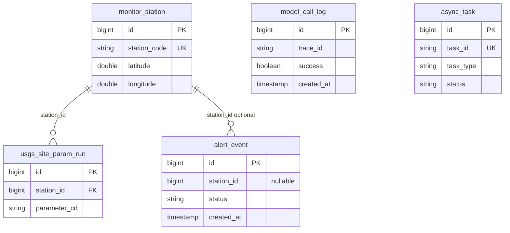

# 数据库表结构及表关系说明

本文描述 `monitor_business` 当前由 JPA（`ddl-auto=update`）维护的表、字段含义及**逻辑关联**。

- **默认库**：**PostgreSQL**（连接说明见 [postgresql-setup.md](./postgresql-setup.md)）。
- **可选**：`spring.profiles.active=h2` 时使用 **H2 文件库**（`application-h2.properties`）。

实体层未声明 `@ManyToOne` / `@JoinColumn`，外键仅在业务与字段命名上约定一致；若后续需要数据库级 FK，可再增加迁移脚本。

**移除说明**：历史表 `water_quality_record` 及 `alert_event` / `model_call_log` 上的 `water_quality_record_id` 列已从应用模型删除。存量 PostgreSQL 可执行 `scripts/drop_water_quality_record.sql` 做一次性清理。

---

## 1. 关系总览（当前）

**文字归纳：**

| 关系 | 说明 |
|------|------|
| `monitor_station` → `usgs_site_param_run` | 按 `station_id` 关联；USGS 单参数 IV 巡检/异常检测运行记录。 |
| `monitor_station` → `alert_event` | 可选冗余 `alert_event.station_id`。 |
| `async_task` | 异步任务（IV 刷新、批量预测等），与站点表无强制外键。 |
| `auto_forecast_settings` | 单例配置表（`id = 1`）。 |
| `model_call_log` | AI 调用日志（审计）；当前代码路径若未写入则表可为空。 |

**与链路追踪：** `model_call_log.trace_id` 与请求 MDC / `X-Trace-Id` 对齐。

---

## 2. 表：`alert_event`

告警事件表；规则包括浊度阈值、USGS 参数异常、预测阈值等。

| 列名（DB） | 含义 |
|------------|------|
| `id` | 主键 |
| `station_id` | 可空；冗余站点 |
| `alert_type` | 告警类型 |
| `severity` | 严重度 |
| `status` | `NEW` / `ACK` / `CLOSED` 等 |
| `pollution_level` | 触发时等级快照（如适用） |
| `title` / `detail` | 标题与说明 |
| `rule_code` | 规则标识 |
| `created_at` | 产生时间 |
| `acknowledged_at` / `acknowledged_by` | 确认信息 |
| `closed_at` / `closed_by` / `remark` | 关闭信息 |

---

## 3. 表：`model_call_log`

模型调用日志，用于审计与排障。

| 列名（DB） | 含义 |
|------------|------|
| `id` | 主键 |
| `trace_id` | 链路 ID |
| `success` | 是否调用成功 |
| `http_status` | HTTP 状态（若可得） |
| `duration_ms` | 耗时 |
| `error_message` | 失败摘要 |
| `request_json` / `response_json` | 请求/响应 JSON 摘要（有长度限制） |
| `created_at` | 记录时间 |

---

## 4. 表：`monitor_station`

监测站点主数据。

| 列名（DB） | 含义 |
|------------|------|
| `id` | 主键 |
| `station_code` | 唯一站编码 |
| `station_name` | 展示名 |
| `province` / `city` | 省、市 |
| `latitude` / `longitude` | WGS84 经纬度 |
| `external_id` | 可选；如 USGS NWIS 8 位 `site_no` |
| `status` | 如 `ACTIVE` / `INACTIVE`，默认 `ACTIVE` |
| `created_at` / `updated_at` | 时间戳 |

---

## 5. 表：`async_task`

异步任务状态（IV 刷新、批量预测等）。

| 列名（DB） | 含义 |
|------------|------|
| `id` | 主键 |
| `task_id` | 对外任务 ID（UUID） |
| `idempotency_key` | 与 `task_type` 组合唯一；未传则为 null |
| `task_type` | `IV_REFRESH`、`FORECAST_BATCH_RUN_NOW` 等 |
| `status` | `PENDING`、`RUNNING`、`RETRYING`、`SUCCEEDED`、`FAILED`、`CANCELLED` |
| `progress_percent` | 进度 0–100 |
| `current_step` | 当前步骤描述 |
| `payload_json` / `result_json` | 请求负载与结果 JSON |
| `error_message` | 失败信息 |
| `retry_count` | 重试次数 |
| `created_at` / `updated_at` / `started_at` / `finished_at` | 时间戳 |

唯一约束：`uk_async_task_type_idempotency`（`task_type`, `idempotency_key`）。

---

## 6. 表：`auto_forecast_settings`（单例）

定时自动预测总开关与上次运行摘要。

| 列名（DB） | 含义 |
|------------|------|
| `id` | 固定为 `1` |
| `enabled` | 是否启用自动预测 |
| `last_run_at` | 上次运行时间 |
| `last_run_summary` | 上次运行摘要文本 |

---

## 7. 表：`usgs_site_param_run`

USGS 单参数 IV 巡检运行记录。

| 列名（DB） | 含义 |
|------------|------|
| `id` | 主键 |
| `station_id` | 关联 `monitor_station.id` |
| `parameter_cd` | 参数码 |
| `sample_timestamp` | 样本时间戳字符串 |
| `is_anomaly` | 是否判定异常 |
| `alert_created` | 是否已生成告警 |
| `created_at` | 写入时间 |

---

## 8. 当前未落地的表

架构中曾规划的 **`rule_config`** 等表**仍未实现**（见 [TODO.md](./TODO.md)）。

---

## 9. 与代码的对应关系

| 表名 | JPA 实体 |
|------|----------|
| `monitor_station` | `MonitorStation` |
| `alert_event` | `AlertEvent` |
| `model_call_log` | `ModelCallLog` |
| `async_task` | `AsyncTask` |
| `auto_forecast_settings` | `AutoForecastSettings` |
| `usgs_site_param_run` | `UsgsSiteParamRun` |

枚举：`AsyncTaskType`、`AsyncTaskStatus`。

---

## 10. 演进备注

站点维度、CSV 导入与检测时间等规划见历史版本文档；当前以 **`monitor_station`** + **`usgs_site_param_run`** + **`alert_event`** 为主线。
